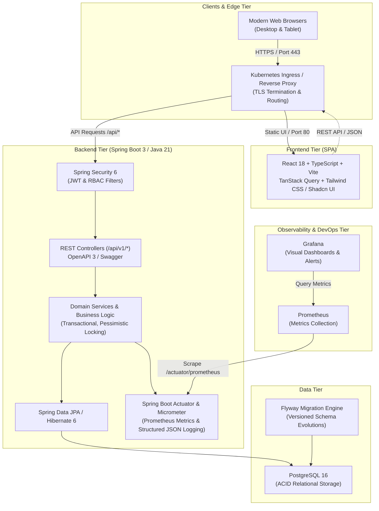

# System Architecture: Library Management System

## 1. Overview & Architectural Principles

The Library Management System (LMS) is an enterprise-grade, cloud-native web application designed to manage book catalogs, library members, loan transactions, inventory tracking, and administrative audit logging. The architecture prioritizes **security, data consistency, scalability, observability, and developer experience**.

---

## 2. Component Architecture

### 2.1 Frontend Tier
- **Framework**: React 18 with TypeScript and Vite.
- **State Management**: TanStack Query (React Query) for server state caching, invalidation, and optimistic updates; React Context for local UI & authentication state.
- **Routing**: React Router v6 with protected route guards, role-based view isolation, and lazy-loaded route chunks.
- **UI & Styling**: Clean, modern responsive component design (Tailwind CSS with accessible UI primitives), featuring toast notifications, confirmation modals, data tables with server pagination/sorting/filtering, responsive navigation bar, and dark/light support.
- **HTTP Client**: Axios with interceptors handling `X-Request-ID` correlation propagation, automated JWT refresh token rotation, and standardized error parsing.

### 2.2 Backend Tier
- **Runtime & Framework**: Java 21 (LTS) with Spring Boot 3.3.x.
- **Architecture Pattern**: Layered Clean Architecture (Controller -> DTO -> Service -> Repository -> Entity) with strict separation of domain models and presentation transfer objects.
- **Concurrency & Transaction Management**:
  - Declarative `@Transactional` boundaries with ACID guarantees.
  - Concurrency control for book inventory: Pessimistic locking (`PESSIMISTIC_WRITE`) during issue/return operations to prevent race conditions and inventory overselling under high concurrency.
  - Atomic copy decrement/increment with database CHECK constraints (`available_copies >= 0` and `available_copies <= total_copies`).
- **Validation**: JSR-380 / Jakarta Bean Validation with customized error translators for field-level errors.
- **API Documentation**: SpringDoc OpenAPI 3.0 generating interactive Swagger UI at `/swagger-ui.html`.

### 2.3 Database & Persistence Tier
- **Database**: PostgreSQL 16.
- **Schema Management**: Flyway versioned migrations (`V1__...`, `V2__...`) guaranteeing deterministic database evolution across environments.
- **Connection Pooling**: HikariCP tuned for production throughput with health monitoring.
- **Indexes**: Composite indexes for catalog searches (ISBN, title, author, category), membership lookups, and active loan queries (due dates and statuses).

### 2.4 Security Architecture
- **Authentication**: Stateless JWT authentication with short-lived access tokens (15 minutes) and cryptographically secure, HttpOnly/SameSite refresh tokens.
- **Password Hashing**: BCrypt with configurable cost factor (strength 12).
- **Authorization**: Role-Based Access Control (RBAC) enforced via `@PreAuthorize` annotations on backend endpoints and client-side conditional rendering.
- **Roles**:
  - `ADMIN`: Full system administrative access, user management, audit log viewing, catalog & loan management.
  - `LIBRARIAN`: Catalog management, member registration, loan issuance and returns.
  - `MEMBER`: Personal profile, borrowing history, active loans, and catalog browsing.

### 2.5 Observability Architecture
- **Metrics**: Spring Boot Actuator with Micrometer exporting to Prometheus at `/actuator/prometheus`.
  - Custom metrics: loan transaction rate, return rate, overdue loan gauges, copy availability gauges.
- **Logging**: Structured JSON logging using Logback with Logstash encoder. Every request is tagged with a UUID `requestId` stored in MDC (Mapped Diagnostic Context) and mirrored in API responses.
- **Health Checks**: Actuator liveness (`/actuator/health/liveness`) and readiness (`/actuator/health/readiness`) probes connected to Kubernetes orchestration.

---

## 3. Deployment Architecture

### 3.1 Local Development (Docker Compose)
Docker Compose orchestrates:
- `backend`: Spring Boot application running on port 8080.
- `frontend`: React SPA served via Nginx on port 3000 (proxying `/api` to backend).
- `postgres`: PostgreSQL 16 running on port 5432 with persistent volume.
- `prometheus`: Scrapes backend actuator endpoints on port 9090.
- `grafana`: Preconfigured dashboards for JVM, HTTP throughput, and library KPIs on port 3001.

### 3.2 Production Deployment (Kubernetes)
Production manifests (Kustomize/Helm) define:
- Isolated namespaces (`library-system`).
- High availability deployments with Horizontal Pod Autoscaling (HPA) and Pod Disruption Budgets (PDB).
- ConfigMaps for environment-specific configurations.
- Kubernetes Secrets for database credentials and JWT signing keys.
- Ingress controller with TLS termination and security headers.
- NetworkPolicies restricting direct database access exclusively to backend pods.
