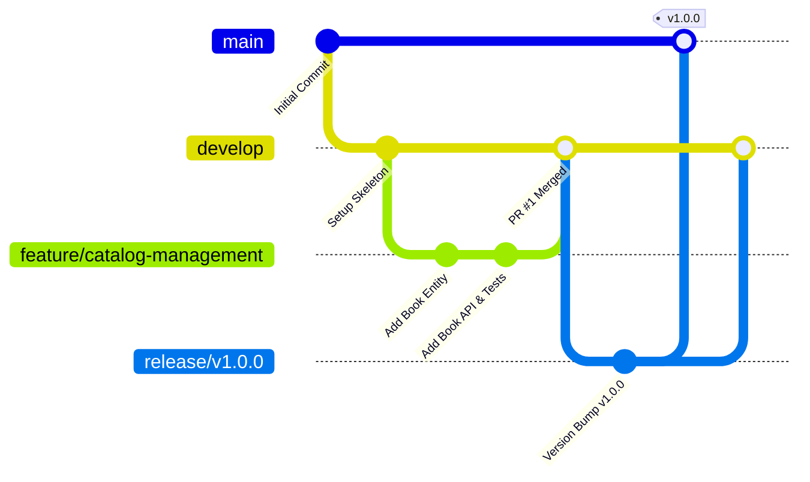

# Git Branching Strategy & Development Workflow

## 1. Branching Model (GitFlow / Trunk-Based with Feature Branches)



---

## 2. Branch Conventions

| Branch Name | Purpose | Merged Into | Rules |
|---|---|---|---|
| `main` | Production-ready stable code. | None (Root) | Protected. Direct push prohibited. Requires passing CI & PR approval. |
| `develop` | Integration branch for ongoing sprint work. | `main` | Protected. All feature branches merge here via PR. |
| `feature/<short-desc>` | Dedicated feature development. | `develop` | Branch from latest `develop`. Delete after merge. |
| `bugfix/<short-desc>` | Non-critical bug fixes. | `develop` | Branch from `develop`. |
| `hotfix/<short-desc>` | Critical production fixes. | `main` & `develop` | Branch directly from `main`. Tagged upon merge. |
| `release/<version>` | Release stabilization & preparation. | `main` & `develop` | Version freeze and tag creation. |

---

## 3. Commit & Pull Request Standards

### 3.1 Conventional Commits
All commit messages must adhere to the Conventional Commits specification:
```
<type>(<scope>): <short summary>

[optional body]

[optional footer(s)]
```
Types:
- `feat`: New feature for the user or system
- `fix`: Bug fix
- `docs`: Documentation updates
- `style`: Formatting, missing semicolons, etc.
- `refactor`: Refactoring code without altering functionality
- `test`: Adding or updating test cases
- `chore`: Tooling, build scripts, dependency upgrades
- `ci`: CI/CD pipeline changes

### 3.2 Pull Request Checklist
Every Pull Request must include:
1. **Summary & Rationale**: High-level problem statement and solution.
2. **Scope of Changes**: List of modified modules and new endpoints/components.
3. **Verification**: Automated test results, unit/integration coverage details, and UI screenshots.
4. **Database Impact**: Details of Flyway migrations and schema compatibility.
5. **Security & Performance Considerations**: Threat model impacts, authorization checks, and index updates.
