# CI/CD Pipeline & Artifact Repository Strategy

## 1. Continuous Integration & Continuous Delivery (CI/CD)

The system uses GitHub Actions (or compatible OCI runners) for full-lifecycle pipeline automation.

```mermaid
flowchart LR
    subgraph Stage1["1. Verification & Quality"]
        Lint["Lint & Format\n(ESLint, Prettier, Checkstyle)"]
        UnitTests["Unit Tests\n(JUnit 5, Vitest)"]
        SecScan["Security Scan\n(Trivy / OWASP)"]
    end

    subgraph Stage2["2. Integration & E2E"]
        IntTests["Integration Tests\n(Testcontainers PG)"]
        E2ETests["E2E Tests\n(Playwright UI)"]
        Coverage["Coverage Gate\n(JaCoCo >= 80%)"]
    end

    subgraph Stage3["3. Build & Artifacts"]
        BuildBE["Build Spring Boot JAR"]
        BuildFE["Build React SPA"]
        DockerBuild["Build OCI Images\n(Backend & Frontend)"]
        PublishRegistry["Publish to Registry\n(GHCR / DockerHub / Private)"]
    end

    subgraph Stage4["4. Continuous Deployment"]
        K8sDeploy["Deploy to K8s\n(Helm / Kustomize)"]
        SmokeTests["Post-Deploy Smoke Tests"]
    end

    Lint --> UnitTests --> SecScan
    SecScan --> IntTests --> E2ETests --> Coverage
    Coverage --> BuildBE & BuildFE
    BuildBE & BuildFE --> DockerBuild --> PublishRegistry
    PublishRegistry --> K8sDeploy --> SmokeTests
```

---

## 2. Artifact & Image Publishing Strategy

- **Registries Supported**:
  - GitHub Packages / Container Registry (`ghcr.io`)
  - Docker Hub (`docker.io`)
  - Private OCI-compliant registries (e.g., Harbor, AWS ECR, GCP Artifact Registry)
- **Tagging Strategy**:
  - `ghcr.io/org/library-backend:<git-sha>` (Immutable artifact tag)
  - `ghcr.io/org/library-backend:v1.0.0` (SemVer release tag)
  - `ghcr.io/org/library-backend:latest` (Development tracking only)
- **Provenance & SBOM**:
  - Generates Software Bill of Materials (SBOM) using Syft/CycloneDX.
  - Image signing with Cosign.

---

## 3. Pipeline Configuration & Secrets

Required CI Secrets:
- `REGISTRY_URL`: Registry endpoint (e.g., `ghcr.io`)
- `REGISTRY_USERNAME`: User or bot account
- `REGISTRY_PASSWORD`: Access token with write permissions
- `KUBE_CONFIG`: Base64 encoded kubeconfig for target cluster (dev/staging/prod)
- `JWT_SECRET`: Signing secret for automated integration tests
