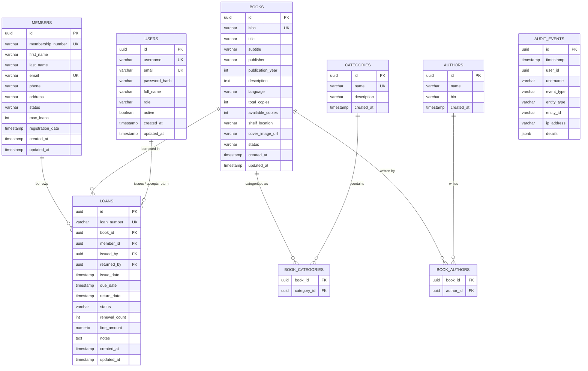

# Domain Model & Entity Relationships

## 1. Domain Entities & Value Objects

The domain encapsulates four primary aggregates:
1. **User Aggregate**: System authentication and administrative users.
2. **Member Aggregate**: Library patrons eligible for borrowing.
3. **Book & Catalog Aggregate**: Books, Authors, Categories, and physical inventory copies.
4. **Loan Transaction Aggregate**: Checkouts, renewals, returns, and overdue tracking.
5. **Audit Event Aggregate**: Immutable append-only operational audit trail.

---

## 2. Entity Relationship Diagram

---

## 3. Detailed Entity Definitions

### 3.1 `User`
- **Fields**: `id` (UUID), `username` (Unique), `email` (Unique), `passwordHash`, `fullName`, `role` (`ADMIN`, `LIBRARIAN`, `MEMBER`), `active` (boolean), `createdAt`, `updatedAt`.
- **Invariants**: Username and email must be normalized (lowercase) and unique. Password must never be exposed or returned in DTOs.

### 3.2 `Member`
- **Fields**: `id` (UUID), `membershipNumber` (Unique, e.g. `MEM-2026-0001`), `firstName`, `lastName`, `email` (Unique), `phone`, `address`, `status` (`ACTIVE`, `SUSPENDED`, `INACTIVE`), `maxLoans` (default: 5), `registrationDate`, `createdAt`, `updatedAt`.
- **Invariants**: Only `ACTIVE` members can borrow books. Maximum active loans cannot exceed `maxLoans`.

### 3.3 `Book`
- **Fields**: `id` (UUID), `isbn` (Unique, ISBN-10 or ISBN-13 format), `title`, `subtitle`, `publisher`, `publicationYear`, `description`, `language`, `totalCopies`, `availableCopies`, `shelfLocation`, `coverImageUrl`, `status` (`ACTIVE`, `MAINTENANCE`, `RETIRED`), `createdAt`, `updatedAt`.
- **Invariants**:
  - `availableCopies >= 0`
  - `availableCopies <= totalCopies`
  - Total copies cannot be reduced below `(totalCopies - availableCopies)` (i.e., currently borrowed copies).

### 3.4 `Loan` (Transaction)
- **Fields**: `id` (UUID), `loanNumber` (Unique, e.g. `TXN-2026-0001`), `book` (ManyToOne), `member` (ManyToOne), `issuedBy` (ManyToOne User), `returnedBy` (ManyToOne User, nullable), `issueDate`, `dueDate`, `returnDate` (nullable), `status` (`ISSUED`, `RETURNED`, `OVERDUE`, `LOST`, `CANCELLED`), `renewalCount` (int, default 0), `fineAmount` (BigDecimal, default 0.00), `notes`, `createdAt`, `updatedAt`.
- **Business Invariants**:
  - **Issue**: Checks member is active, member active loan count < `maxLoans`, member does not already hold an active copy of the same book, book is active and `availableCopies > 0`. Atomically decrements `availableCopies` with pessimistic lock on Book row.
  - **Return**: Checks loan is currently `ISSUED` or `OVERDUE`. Sets `returnDate = now()`, `status = RETURNED`. Atomically increments `availableCopies`. Calculates days overdue and applies fine if applicable.
  - **Renew**: Checks `renewalCount < 2`, not overdue, and book is active. Extends `dueDate` by standard loan period (14 days) and increments `renewalCount`.
  - **Lost**: Marks book as `LOST`. Does not increment available copies; decrements `totalCopies`.

### 3.5 `AuditEvent`
- **Fields**: `id` (UUID), `timestamp`, `userId` (UUID, nullable for system actions), `username`, `eventType` (`BOOK_CREATED`, `BOOK_UPDATED`, `BOOK_DEACTIVATED`, `MEMBER_REGISTERED`, `MEMBER_SUSPENDED`, `LOAN_ISSUED`, `LOAN_RETURNED`, `LOAN_RENEWED`, `USER_LOGIN`, `USER_CREATED`), `entityType` (`BOOK`, `MEMBER`, `LOAN`, `USER`), `entityId`, `ipAddress`, `details` (JSONB / text).
