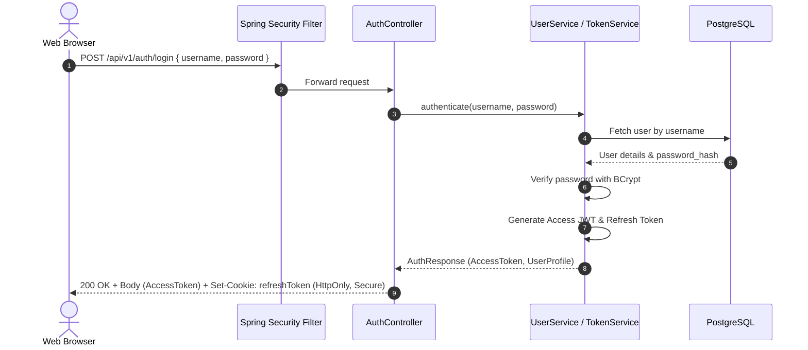

# Security Model & Authorization Matrix

## 1. Authentication Architecture

### 1.1 Token Strategy
The system implements a stateless JWT (JSON Web Token) authentication architecture combined with secure refresh token rotation:
- **Access Token**: Short-lived (15 minutes), digitally signed using HMAC-SHA256 (or RSA-256 in production), transmitted in the `Authorization: Bearer <token>` header. Contains standard claims (`sub`, `roles`, `userId`, `exp`, `iat`, `jti`).
- **Refresh Token**: Long-lived (7 days), stored in an `HttpOnly`, `Secure`, `SameSite=Strict` cookie, protecting against Cross-Site Scripting (XSS) and Cross-Site Request Forgery (CSRF).
- **Password Hashing**: BCrypt hashing with adaptive work factor (strength 12) with salted digests. Plaintext passwords are never logged or stored.

### 1.2 Authentication Flow

---

## 2. Role-Based Access Control (RBAC) Matrix

| Resource / Action | Endpoint / Operation | Public | MEMBER | LIBRARIAN | ADMIN |
|---|---|:---:|:---:|:---:|:---:|
| **Auth** | Login (`POST /auth/login`) | ✅ | ✅ | ✅ | ✅ |
| | Refresh Token (`POST /auth/refresh`) | ❌ | ✅ | ✅ | ✅ |
| | Logout (`POST /auth/logout`) | ❌ | ✅ | ✅ | ✅ |
| | Current User (`GET /auth/me`) | ❌ | ✅ | ✅ | ✅ |
| **Catalog** | Search & View Books (`GET /books/**`) | ❌ | ✅ | ✅ | ✅ |
| | Create Book (`POST /books`) | ❌ | ❌ | ✅ | ✅ |
| | Update Book (`PUT /books/{id}`) | ❌ | ❌ | ✅ | ✅ |
| | Change Book Status (`PATCH /books/{id}/status`) | ❌ | ❌ | ✅ | ✅ |
| | Manage Categories/Authors (`POST/PUT /categories`, `POST/PUT /authors`) | ❌ | ❌ | ✅ | ✅ |
| **Members** | View Member List (`GET /members`) | ❌ | ❌ | ✅ | ✅ |
| | View Member Details (`GET /members/{id}`) | ❌ | Self Only | ✅ | ✅ |
| | Register Member (`POST /members`) | ❌ | ❌ | ✅ | ✅ |
| | Update Member (`PUT /members/{id}`) | ❌ | ❌ | ✅ | ✅ |
| | Change Member Status (`PATCH /members/{id}/status`) | ❌ | ❌ | ✅ | ✅ |
| **Loans** | View All Loans (`GET /loans`) | ❌ | ❌ | ✅ | ✅ |
| | View Own Loans (`GET /members/{id}/loans`) | ❌ | Self Only | ✅ | ✅ |
| | Issue Book (`POST /loans/issue`) | ❌ | ❌ | ✅ | ✅ |
| | Return Book (`POST /loans/{id}/return`) | ❌ | ❌ | ✅ | ✅ |
| | Renew Loan (`POST /loans/{id}/renew`) | ❌ | ❌ | ✅ | ✅ |
| | Mark Lost (`POST /loans/{id}/lost`) | ❌ | ❌ | ✅ | ✅ |
| | Cancel Loan (`POST /loans/{id}/cancel`) | ❌ | ❌ | ❌ | ✅ |
| **Dashboard** | View Statistics (`GET /dashboard/**`) | ❌ | ❌ | ✅ | ✅ |
| **Users** | User Management (`GET/POST/PUT /users/**`) | ❌ | ❌ | ❌ | ✅ |
| **Audit** | View Audit Logs (`GET /audit/**`) | ❌ | ❌ | ❌ | ✅ |

---

## 3. Defense-in-Depth & Security Controls

1. **Input Validation & Sanitization**:
   - Jakarta Bean Validation on all incoming DTOs (`@NotBlank`, `@Size`, `@Pattern`, `@PositiveOrZero`).
   - SQL Injection prevention using Spring Data JPA parameterized queries and Criteria API.
   - XSS sanitization on user input rendered in frontend.

2. **CORS & CSRF Protection**:
   - Strictly configured Cross-Origin Resource Sharing (CORS) allowing only trusted origins.
   - CSRF protection: API endpoints are stateless with Bearer tokens; refresh token cookie is configured with `SameSite=Strict`.

3. **Rate Limiting & Brute Force Defense**:
   - In-memory / Redis token bucket rate limiting on `/api/v1/auth/login` to prevent credential stuffing.

4. **Security Headers**:
   - `Content-Security-Policy`: `default-src 'self'`
   - `X-Content-Type-Options`: `nosniff`
   - `X-Frame-Options`: `DENY`
   - `Strict-Transport-Security`: `max-age=31536000; includeSubDomains`

5. **Secrets Management**:
   - Zero plaintext secrets in code or repository.
   - Environment variables used for all credentials (`JWT_SECRET`, `SPRING_DATASOURCE_PASSWORD`).
